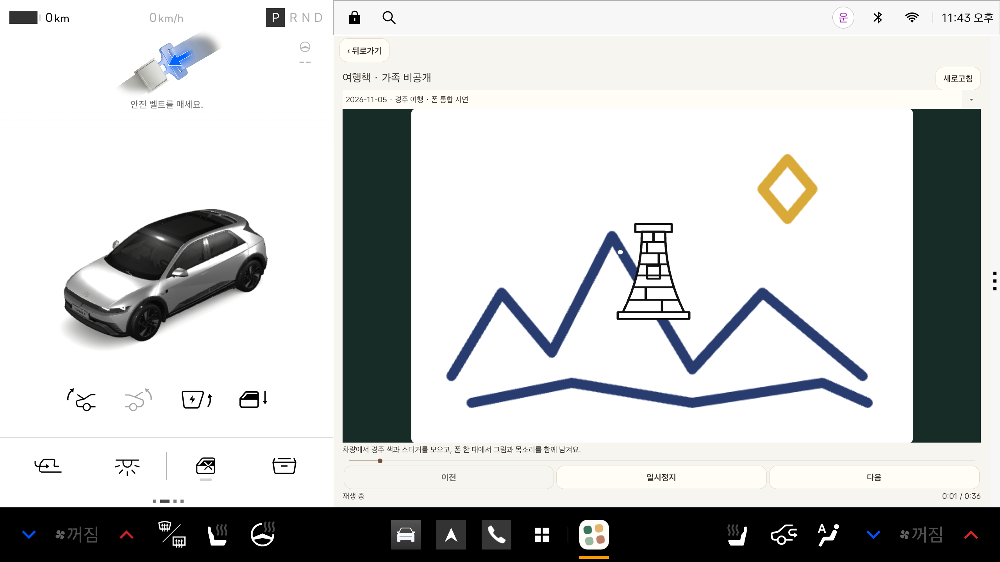
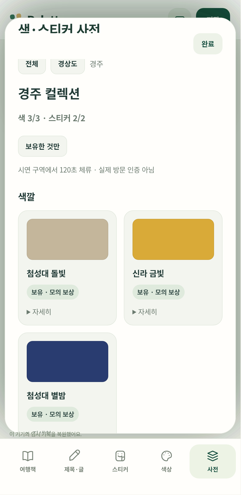
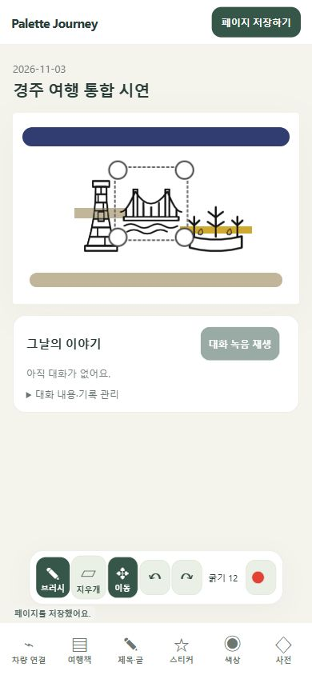
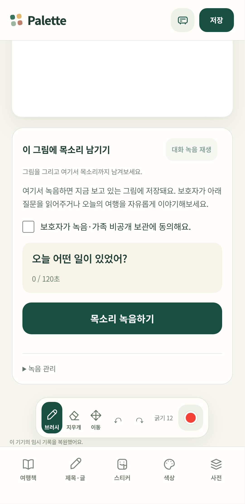
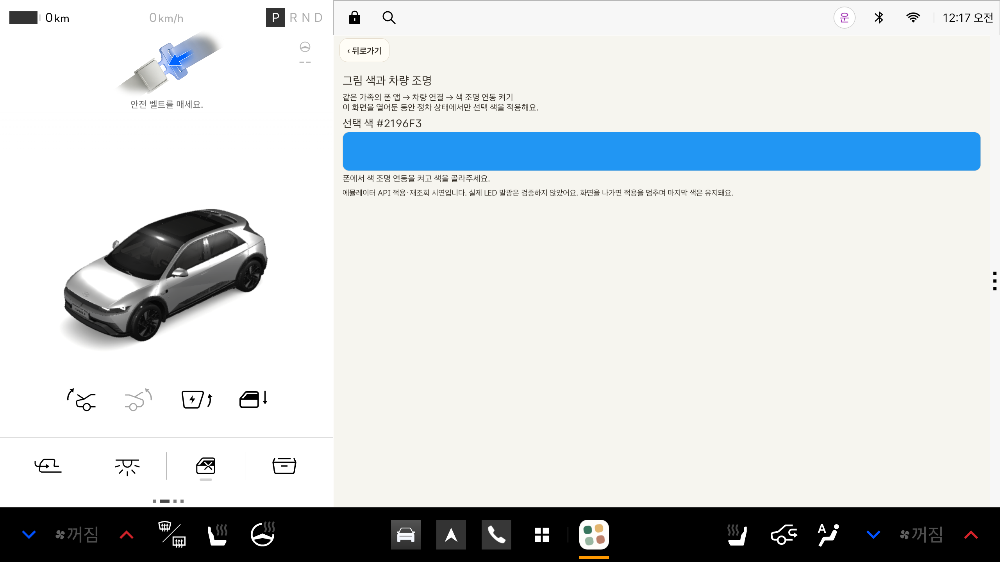

# Palette Journey | 가족 여행 그림일기

**경주에서 모은 색으로 첨성대를 그리고, 그날의 가족 목소리를 그림에 남겨요.**

팔레트는 어린 자녀와 자동차로 여행하는 가족을 위한 그림일기 앱입니다. 아이는 여행에서 얻은 색과 스티커로 그림을 그리고, 보호자와 나눈 이야기를 같은 페이지에 녹음합니다. 정차한 차에서는 그림의 색을 앰비언트 조명으로 비추고, 차량 여행책에서 그림과 목소리를 함께 감상합니다.

*Pleos Connect 에뮬레이터에서 경주 그림일기를 열고 녹음을 재생한 화면입니다.*

## 한 가족의 경주 여행

1. **여행지의 색을 모아요.** 차량에서 경주 도착을 시연하면 지역 색 3개와 스티커 2개가 같은 가족의 폰에 열립니다.
2. **그림과 목소리로 오늘을 남겨요.** 아이가 첨성대를 그리고, 보호자와 “오늘 뭐가 제일 기억에 남았어?”라고 이야기합니다. 그림·스티커·녹음이 한 페이지에 저장됩니다.
3. **정차한 차에서 그림을 감상해요.** 폰에서 고른 색을 차량 조명에 적용해 같은 색인지 확인합니다. 차량 여행책에서 그림을 열면 그날의 가족 목소리도 들을 수 있습니다.
4. **다음 여행에서 그날을 다시 만나요.** 같은 지역을 모의 재방문하면 가족의 지난 그림일기가 안내 카드로 나타납니다.

## 다운로드 및 실행

| 파일 | 설치 대상 | 하는 일 |
| --- | --- | --- |
| [차량 앱 release APK](apk/박동민_PaletteJourney_release.apk) | Pleos Connect 에뮬레이터 | 가족 연결, 지역 콘텐츠 수집, 조명 연동, 여행책 감상 |
| [폰 보조 앱 release APK](apk/박동민_PaletteJourneyCompanion_release.apk) | Android 폰 에뮬레이터 | 그림·스티커·녹음 작성 및 저장 |

두 앱은 같은 PC의 서버를 사용합니다. [처음부터 따라 하는 시연 가이드](MVP_FLOW.md)에 서버 시작, APK 설치, 가족 연결부터 여행책 감상까지 화면 순서대로 정리했습니다. [APK 체크섬과 빌드 방법](apk/README.md)도 확인할 수 있습니다.

## 테스트 환경과 필요한 설정

| 항목 | 시연 환경 |
| --- | --- |
| PC 및 서버 | Windows, Node.js 24 이상 (검증 버전 24.21.0), SQLite 내장 모듈 사용, 별도 npm 패키지 설치 불필요 |
| 차량 | Pleos Connect Emulator v2.1.0, Android 14 / API 34, x86_64 |
| 차량 화면 | 가로 2560 × 세로 1440px, 160dpi, 가로 방향 |
| 폰 | Pixel 10a Android 에뮬레이터, API 37 Google Play x86_64 |
| 폰 화면 | 가로 1080 × 세로 2424px, 420dpi, 세로 방향 (앱 최소 지원 API 34) |
| 제출 빌드 | 별도 키로 서명한 release APK, `debuggable=false`, 에뮬레이터 시연 기능 명시 활성화 |
| 차량 SDK | Vehicle 2.3.2, FusedLocation 1.1.3, TTS / STT 3.3.1 |

차량은 `http://10.0.2.2:3000`으로 PC 서버에 연결합니다. 폰은 `adb reverse tcp:3000 tcp:3000` 설정 후 `http://localhost:3000`을 사용합니다. PC 서버를 켜두어야 연결·저장·동기화가 가능합니다. 모의 방문은 서버의 `PALETTE_MOCK_LOCATION=1`, 잠금 상태 시연은 `PALETTE_DEV_UNLOCK_STICKERS=0`으로 실행합니다. 필요한 명령은 [시연 가이드 1절](MVP_FLOW.md#1-서버와-두-앱-준비)에 있습니다.

주행·조명 시연에는 차량 Virtual Console과 ADB 8088 포트 전달이 필요합니다. 음성 기록은 폰 앱 마이크 권한과 에뮬레이터의 호스트 마이크 입력을 켭니다. 모의 주행과 조명 API 재조회는 에뮬레이터 검증이며 실차 방문·LED 발광 검증을 의미하지 않습니다. 제출용 차량 앱은 실제 차량에서 시연 조작을 허용하지 않습니다.

제출용 앱의 패키지는 차량 `com.palettejourney.submission`, 폰 `com.palettejourney.companion.submission`입니다. 기존 debug 앱과 나란히 설치되며 가족 연결은 새로 해야 합니다. 기존 앱의 그림·녹음을 지우거나 자동으로 옮기지 않습니다.

## MVP 시연 화면

| 경주 모의 방문 보상 | 휴대폰 그림 편집 | 휴대폰에서 목소리 남기기 |
| --- | --- | --- |
|  |  |  |
| 경주 모의 방문으로 얻은 색과 스티커를 사전에서 확인합니다. | 지역 색과 스티커를 골라 그림일기를 꾸밉니다. | 보호자 동의 후 해당 페이지에 목소리를 녹음합니다. |

*정차한 Pleos Connect 에뮬레이터의 조명 연동 화면입니다. 색상 적용과 재조회 절차는 [조명 시연 가이드](AMBIENT_DEMO.md)에 있습니다.*

경주 보상과 휴대폰 녹음 화면은 11월 10일에 다시 캡처했습니다. 차량 여행책 재생, 휴대폰 그림 편집, 차량 조명은 이전 MVP 시연에서 캡처한 화면입니다.

## 시연에서 확인할 수 있는 범위

| 항목 | 확인한 결과 |
| --- | --- |
| 지역 수집 | 에뮬레이터 속도·기어를 이용한 300m 모의 이동과 정차 후 경주 보상 해금, 폰 반영 |
| 가족 여행책 | 폰의 그림·스티커·실제 가족 음성 저장, 다시 열기, 차량에서 재생 완료 |
| 정차 중 조명 | 파랑·보라·빨강·흰색의 원본 HEX와 Pleos Vehicle SDK 재조회 값 일치, 주행 기어에서 적용 차단 |
| 재방문 | 모의 재방문에서 과거 그림일기 열기, 같은 방문에서 중복 안내 억제 |

지역 방문과 조명은 에뮬레이터 시연 범위입니다. 실차 방문 판정과 LED 발광은 검증 전입니다. 시연의 음성은 부모와 아이가 나눈 실제 대화를 사용합니다.

[지역 콘텐츠](CONTENT_CATALOG.md) · [조명 시연](AMBIENT_DEMO.md) · [개발 기록](docs/development/)
